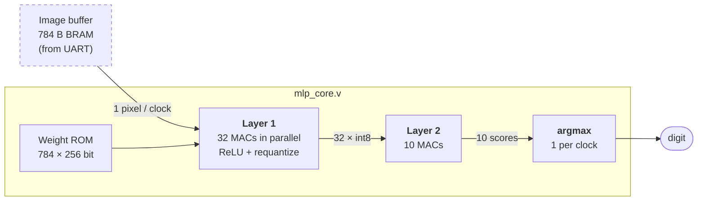

# FPGA int8 MLP Accelerator

A hardware neural-network inference engine for handwritten-digit recognition (MNIST), written in Verilog for the **Digilent Basys 3** (AMD Artix-7). A 784 → 32 → 10 network is trained in PyTorch, quantized to 8-bit integers, and run on dedicated parallel multiply-accumulate hardware. The hardware matches the Python model **bit for bit**.

> **Status:** the full classifier works in simulation: pixels in, digit out, matching the Python model exactly. Next is the board-level design: image buffer, UART link to a PC, and an on-board accuracy run. See [`docs/progress.pdf`](docs/progress.pdf).

## Results so far

| | |
|---|---|
| float32 test accuracy (10,000 images) | **95.86%** |
| int8 test accuracy | **95.86%** (no loss from quantization) |
| Hardware accuracy, first 100 test images (simulated) | **99 / 100**, identical to the Python model |
| Latency, pixels to digit | **832 cycles = 8.32 µs** at 100 MHz |
| Throughput, images streamed back to back | **~120,000 images/s** |
| Resources (Yosys estimate) | 42 of 90 DSP slices, 15 RAMB18, ~2.2k LUTs (10%) |
| Weight storage | 24.8 KiB, all on-chip (no external memory) |
| Verification | **14,166 automated checks** across 5 self-checking testbenches |

## How it works


*Solid: built and verified. Dashed: planned.*

Each clock, **one pixel is broadcast to all 32 MACs** while a single 256-bit memory read gives every MAC its own weight for that pixel. All 32 hidden neurons finish together after 784 cycles, then ReLU, round-half-up shift, and clamp to int8, exactly as specified in [`quantize_export.py`](quantize_export.py). Layer 2 repeats the pattern with 10 MACs, and argmax scans the 10 scores one per clock (lowest index wins ties, matching `numpy.argmax`).

## Verification

Python exports **golden vectors**: the exact integer value of every intermediate signal for 64 real test images. Each testbench is self-checking and compares the RTL against them.

| Testbench | Checks | What it covers |
|---|---|---|
| [`sim/tb_mlp_core.v`](sim/tb_mlp_core.v) | 2,880 | end to end: hidden values, scores, and digit for 64 golden images; 100 images streamed; accuracy |
| [`sim/tb_layer1.v`](sim/tb_layer1.v) | 4,259 | all 32 neurons × 64 golden images, synthetic edge-case images, latency and handshake |
| [`sim/tb_layer2.v`](sim/tb_layer2.v) | 737 | layer 2 alone from golden hidden values, synthetic inputs |
| [`sim/tb_argmax.v`](sim/tb_argmax.v) | 4,024 | ties, int32 extremes, signed-compare trap, 2,000 random vectors |
| [`sim/tb_mac.v`](sim/tb_mac.v) | 2,266 | directed edge cases, 2,000 random dot products, golden neurons |

**The testbenches are themselves tested.** We plant realistic bugs in the RTL and confirm each one is caught. This found that real MNIST images hide three bug classes: border pixels are always black, so skipped pixels go unnoticed, and no neuron ever saturates. Synthetic test images close those gaps, including a pipeline-timing bug that passes *every* real image. Likewise, real scores never tie, so a wrong argmax tie-break passes the whole end-to-end test, and only a dedicated tie test catches it. All 25 planted bugs are caught. Full tables are in [`docs/design.pdf`](docs/design.pdf).

## Repository layout

```
src/        synthesizable Verilog (mac.v, layer1.v, layer2.v, argmax.v, mlp_core.v)
sim/        self-checking testbenches
rtl/        generated weights, golden vectors, params.vh (canonical, committed)
scripts/    create_project.tcl (rebuild Vivado project), run_sims.sh (Icarus regression)
docs/       design spec, progress log, setup guide (LaTeX + PDF)
*.py        train_mlp.py (training), quantize_export.py (integer spec + export)
```

## Quick start

**Vivado 2026.1** (Windows/Linux). In the Tcl console on the start screen:
```tcl
source C:/path/to/fpga-mlp-accelerator/scripts/create_project.tcl
```
Then **Run Simulation** and look for `ALL TESTS PASSED`.

**No Vivado** (macOS, or a quick check before pushing), with [Icarus Verilog](https://steveicarus.github.io/iverilog/):
```bash
./scripts/run_sims.sh
```
```
tb_argmax    ALL TESTS PASSED  (4024 checks)
tb_layer1    ALL TESTS PASSED  (4259 checks)
tb_layer2    ALL TESTS PASSED  (737 checks)
tb_mac       ALL TESTS PASSED  (2266 checks)
tb_mlp_core  ALL TESTS PASSED  (2880 checks)
```

Full instructions, including the free Vivado license that 2026.1 requires: [`docs/setup.pdf`](docs/setup.pdf).

## Documentation

- [**Design specification**](docs/design.pdf): architecture, arithmetic contract, timing, verification
- [**Progress log**](docs/progress.pdf): milestones, dated log, open issues
- [**Setup guide**](docs/setup.pdf): toolchain, license, running tests, team workflow

## Team

- Joey ([@itsKannapi](https://github.com/itsKannapi))
- Teammate 2 (TBD)
- Teammate 3 (TBD)
